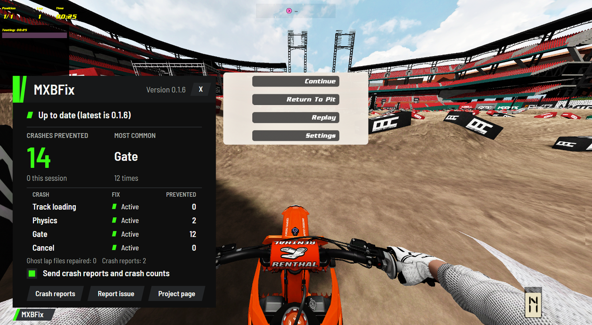
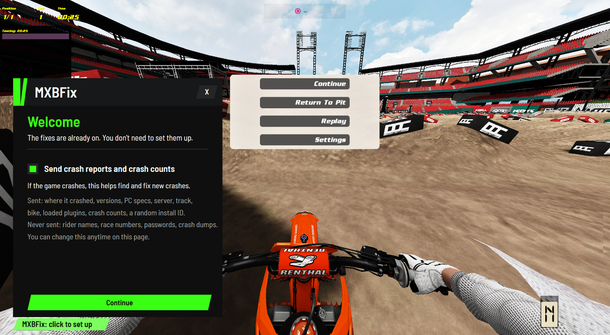
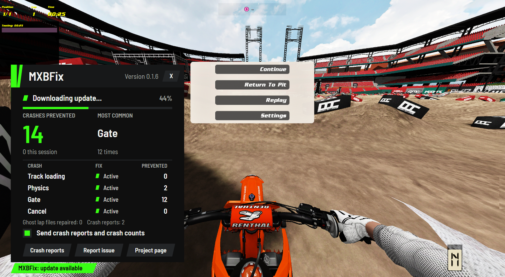

# mxbfix

[](../../releases/latest)
[](../../releases)
[](#crashes-prevented)

[](LICENSE)

Stops the most common MX Bikes crashes.

mxbfix is a plugin for **MX Bikes Beta 21e**. It fixes five bugs in the game. Four of them cover about 65% of the crash reports in
[mxbmrp3's survey](https://github.com/thomas4f/mxbmrp3/blob/main/usage_survey/REPORT.md); the fifth stops the most common
cause of a physics blow-up of your own bike: a fallen bike resting against a thin fence.
If the game still crashes, it saves a report of what happened.



- It doesn't change handling, physics settings or collisions.
- It doesn't change the game's program files. The fixes are applied in memory each time the game starts. The only game
  files it changes are damaged trainer (ghost lap) files, after backing each one up.
- Each code fix only turns on if the game's code is exactly what it was written for. After a game update it stays off.
- Works alongside other plugins (mxbmrp3, ReShade, ...).

## Install

1. Download `mxbfix.dlo` from [Releases](../../releases/latest).
2. In Steam, right-click MX Bikes, then **Manage > Browse local files**.
3. Put `mxbfix.dlo` in the `plugins` folder.
4. Start the game and get on a track.

When your bike is stopped, a green banner asks you to press **Esc**. Click the **MXBFix** tab in the bottom-left corner of
the pause menu and go through the short setup. The fixes are already on by then.



Some antivirus programs may flag the plugin, because it changes the game's code in memory and can update itself. The
source is all here.

## The in-game page

Press **Esc** while on track, move the mouse, and click the MXBFix tab in the bottom-left corner. The page shows your version,
whether you're up to date, how many crashes it has prevented, your most common one and whether each fix is active. Online the game can't
pause, so the tab appears whenever you move the mouse, and the page closes when you open the throttle.

## Updating

When a new version is out, the tab tells you. Click **Install**, then restart the game. The plugin checks the download's
signature before using it and keeps a backup of the current version. It never updates without that click. If the install
can't finish, your current version stays and the page links to the download.



## Crash reports and privacy

**Send crash reports and crash counts** is ticked on the setup screen, and you can untick it there or on the page at any
time, which also stops anything still queued. No reports or counts are sent until you've seen that screen and pressed Continue,
and only crashes from then on are sent.

| | |
|---|---|
| **Sent after a crash or freeze** | Where it crashed, or whether it froze and for how long, the call stack at that moment, game and plugin versions, active fixes, Windows version, CPU, RAM, GPU and driver, ReShade, server name, track, bike, session type, recent game events, the names of loaded plugins and modules, and a random ID for this install |
| **Sent once a day** | How many crashes of each type were prevented. No ID |
| **Kept on your PC only** | CPU register values and the bytes of code at the crash. They could, rarely, hold a fragment of what the game was handling, so they stay in your local report (from 0.1.8; the server deleted them before that) |
| **Never deliberately sent** | Rider names, race numbers, passwords, your Windows user name, file paths, crash dumps |

Reports go to [our server](server), which keeps them privately for 90 days and doesn't store IP addresses. To stop abuse it
briefly uses your address in scrambled form, which changes daily and is never saved. Public
[issues](../../issues) only appear once the maintainer has reviewed a crash type, and only show the crash location, how many reports there are and which versions. The random ID shows
whether one player crashed 50 times or 50 players crashed once. Deleting `mxbfix.ini` replaces it.

The plugin also asks GitHub for the latest version number each time the game starts. `[updates] check=0` turns that off.

### Crashes prevented

The badge at the top adds up the daily counts that plugins report, so treat it as approximate: players with the box off aren't
counted, the server can't prove every count is genuine, and it limits how many it takes per day, so a very busy day catches up later. A "prevented" crash means the plugin handled a situation that crashes the
unfixed game.

## What it fixes

| Crash | When | What was wrong |
|---|---|---|
| Gate crash | A few seconds after riding out of the pits | The game lost half of a memory address while setting up graphics |
| Track loading crash | While a track loads | Damaged trainer (ghost lap) files made the game read garbage |
| Physics: broken rider position | While racing | A rider's position became invalid (NaN), and the game read far outside the map |
| Cancel crash | Cancelling a server join after riding offline | The game cleaned up your trainer twice |
| Physics: bike blow-up at a fence | Usually after a fall, with the bike lying against a thin fence | The collision with the paper-thin fence divided 0 by 0, and the bike's physics broke in one step |

What's planned next: [ROADMAP.md](ROADMAP.md). Found a security problem? See [SECURITY.md](SECURITY.md).

## Removing it

Delete `mxbfix.dlo` and the `mxbfix_data` folder next to it. Trainer files it already repaired stay repaired; the originals
are in `Documents\PiBoSo\MX Bikes\mxbfix\backups\trainers\`.

## Settings

`Documents\PiBoSo\MX Bikes\mxbfix\mxbfix.ini` is created the first time. To turn a fix off:

```ini
[fixes]
ground-nan-guard=0
```

Delete the file to go back to the defaults. That also shows the setup again.

---

## Technical details

### How the fixes are applied

At startup each fix reads the game's code at the exact spot it patches and compares every byte with what it was
written for (game build `0x6A21833D`). Only if everything matches does it write its change, which is always the
same length as the original instructions. Fixes with several parts are all or nothing: if any part doesn't match
or can't be written, nothing is changed. The trainer repair is different: it checks the trainer file format, not
the game build, so it runs on any version.

### The fixes

**`gate-vertex-pointer`**, crash at `mxbikes.exe+0x24085c`. When a render batch gets no GPU buffer, the
per-frame setup at `+0x240aa1` reads four 64-bit buffer addresses with 32-bit loads. If the memory sits above
4 GB, the address loses its top half and the game writes to the wrong place. The fix changes the four loads to
64-bit loads.

**`trainer-series-lookup`**, crash at `msvcr90.dll+0x36ede` while a track loads. A trainer file can hold junk
where the series name goes. The loader at `+0x2083f` looks that name up, ignores that the lookup failed, and uses
an uninitialised index. The fix takes the game's existing "no series" path when the lookup fails.

**`trainer-repair`**, same crash. The game's trainer saver writes a record it never fully fills in, so leftover
memory ends up where the series name goes. At startup the plugin checks every trainer file in
`profiles\*\trainers\` and zeroes that junk (a valid series name, up to 31 characters, is kept). Each changed file
is backed up first.

**`ground-nan-guard`**, physics: broken rider position, crash at `mxbikes.exe+0x1f1923`. Sometimes a rider's position becomes NaN (not a
number); why is still being researched. Three terrain lookups (`+0x1f1720`, `+0x1f11a0`, `+0x1f1d10`) check "outside the map" with
`comiss` + `ja`, which NaN passes, and the height lookup then reads gigabytes outside its grid. The fix flips one
check per coordinate to `comiss` + `jb`, so NaN takes the game's existing "off the map" path. Every ordinary
position gives the same result as before. This stops the crash; it doesn't repair the broken rider, who is
treated as off the map until the position is valid again.

**`trainer-cleanup-reset`**, crash at `mxbikes.exe+0x11d753`. Unloading an event runs a trainer cleanup that
never clears its "trainer loaded" flag. Online events don't load a trainer, so after riding offline, cancelling a
server join runs the cleanup again on objects that are already gone. The fix clears the flag as the cleanup
starts, and makes destroying an already-destroyed object do nothing.

**`fence-contact-nan`**, physics: bike blow-up at a fence, crash at `mxbikes.exe+0x1a29ae`. The sphere-vs-track collision
(`+0x2d75b0`) divides by the distance between a sphere's centre and the closest point on a triangle, then skips the
triangle if the result is negative with `comiss` + `ja`. When a small sphere such as the handlebar end sits exactly on
a zero-thickness fence, that's 0/0 = NaN, which the check lets through: the contact reaches the physics with a NaN
depth and breaks the whole bike, and the next suspension update reads far outside its table. The fix swaps the
comparison to `comiss` + `jb` at `+0x2d7dce`, so NaN is skipped like a negative value. Every ordinary value gives the
same result as before. A bike blow-up can have other causes too (a very hard hit from
another rider); those aren't covered yet.

Verified in game: the gate and cancel crashes happened without the fix and not with it, doing the same thing; a
trainer file that had crashed the game loaded fine with the fix, which logged the junk it handled. The physics
fix is tested against the game's own code. Its first real-world catch was in November 2026: 2 crash values in one
online session, with no crash.

### How updates are verified

Each release is signed with a key that only the maintainer holds, and the plugin holds the matching public key
(`src/update_key.h`). The signature (ECDSA P-256) covers `mxbfix-update|<version>|<SHA-256 of the file>`, so a changed file
or a build passed off as another version is refused. The new plugin goes in beside the current one first, so a crash during the swap can't leave you without a plugin. The
current plugin then moves to `plugins\mxbfix_data\mxbfix.previous`, and the new one takes effect at the next game start. If a new version won't load, delete `mxbfix.dlo` and move that backup back as
`mxbfix.dlo`.

### What it writes

On your PC, everything goes to `Documents\PiBoSo\MX Bikes\mxbfix\`. The only things added to the game's folder are the plugin's
font and its update backup, in `plugins\mxbfix_data\`.

| File | What's in it |
|---|---|
| `mxbfix.log` | This session: which fixes are active, track and bike loaded, bad rider positions, anything a fix caught. `mxbfix.prev.log` is the session before |
| `reports\pending\*.json` | One per crash: where it crashed and why (for known crashes), call stack, loaded modules, what you were doing (track, bike, server name, session, number of riders, last telemetry, last game events) and your PC (Windows, CPU, RAM, GPU and driver, ReShade). No rider names, race numbers, passwords or Windows user name. `reports\sent\` holds the ones already sent, and `reports\rejected\` any the server refused |
| `dumps\*.dmp` | A crash dump for each crash (the newest 3 are kept). Dumps are raw memory and aren't scrubbed: they can contain anything the game had loaded, so only share one if you're comfortable with that. They're never sent automatically |
| `bad_positions.log` | Every rider whose position went bad, with race number, the raw values and how long it lasted. Kept between sessions, up to 1 MB. Stays on your PC |
| `stats.ini` | Running counts: crashes each fix prevented, bad positions seen, trainer files repaired |
| `backups\trainers\` | The original of every trainer file `trainer-repair` changed |
| `session.lock` | Present while the game runs. If it's still there next time, the game didn't close cleanly and a report is written |
| `%TEMP%\mxbfix\alive-*.txt` | One tiny file while the game runs, updated every 2 seconds: when the game last responded and whether Windows saw it hang. Deleted at a clean exit; if the game didn't close cleanly, the next start reads it to tell a freeze from a crash. In the Windows temp folder so it doesn't sync to OneDrive |

### All settings

| Section | Key | Default | Meaning |
|---|---|---|---|
| `[capture]` | `write_dumps` | `1` | Save a crash dump for each crash |
| `[capture]` | `keep_dumps` | `3` | How many crash dumps to keep (about 60 MB each) |
| `[capture]` | `log_bad_positions` | `1` | Log riders whose position goes bad |
| `[ui]` | `enabled` | `1` | `0` turns off the in-game tab and page. With it off, the setup can't run, so nothing is sent |
| `[updates]` | `check` | `1` | `0` stops the check for new versions |
| `[reports]` | `share` | `1` | The Send crash reports and crash counts box |
| `[fixes]` | fix name | `1` | `0` turns that fix off |

### Building

With Zig 0.13: `./build.sh`. The plugin ends up in `dist/mxbfix.dlo`. The server is in [`server/`](server): `npm test`, and
`npx wrangler dev --local` to run it locally.

## Credits

Crash fingerprints and crash statistics from [mxbmrp3](https://github.com/thomas4f/mxbmrp3).

The in-game page uses Barlow Semi Condensed, under the SIL Open Font License (see [FONT-LICENSE.txt](FONT-LICENSE.txt)).

## License

MIT, see [LICENSE](LICENSE).
